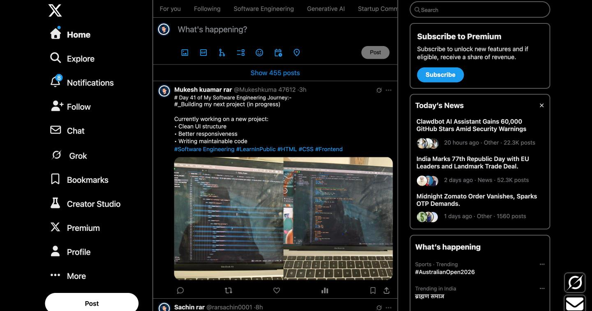

# X — layout clone

A front-end recreation of the X (Twitter) interface, built with HTML and CSS to practise layout work. No JavaScript, no framework — the whole thing is markup and stylesheet.

**Live demo:** https://twitter-zsgb.onrender.com

> Hosted on Render's free tier, which sleeps when idle — the first load can take up to a minute. After that it is quick.

> A learning project. Not affiliated with, endorsed by, or connected to X (Twitter). All X (Twitter) names and logos belong to their owner; they appear here only because the exercise was to reproduce the layout.

---

## Screenshot



## What it covers

- Three-column layout: navigation rail, timeline, trends and suggestions
- Timeline post cards with media, action icons and engagement counts
- Sticky sidebars and the search panel

Roughly 893 lines of HTML and 2168 of CSS.

## Run it

```bash
git clone https://github.com/mukeshkumar-1024/Twitter-clone.git
cd Twitter-clone
open index.html        # or just double-click the file
```


## License

The HTML and CSS here are MIT licensed — see [LICENSE](LICENSE). The images and logos under `assets/` are not mine and are not covered by that license.

## Author

Mukesh Kumar — [GitHub](https://github.com/mukeshkumar-1024) · [LinkedIn](https://linkedin.com/in/mukesh-choudhary-64a9a4378)
